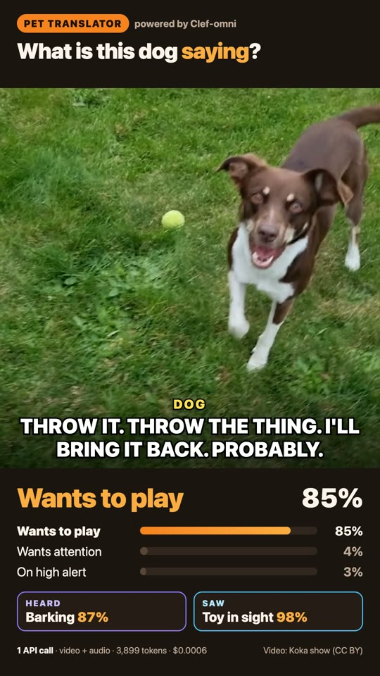
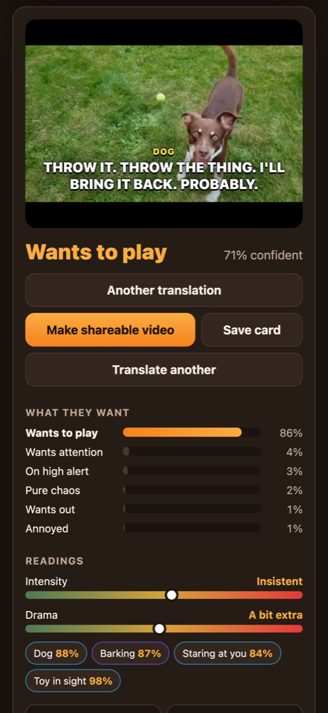

# Pet Translator

Record your pet and find out what they're really saying.

One model hears the bark **and** watches the body language in the same forward pass. [Clef-omni](https://blog.cloudflare.com/clef-faster-cheaper-multimodal/) on Cloudflare Workers AI takes the raw video with its soundtrack and returns calibrated probabilities for 11 questions. There's no transcription step, no captioning, and no LLM writing text.

<p align="center">
  
  
</p>

## How it works

1. The browser records 8 seconds from your camera and mic (noise suppression off, so barks survive), or you upload a clip. Big phone videos are shrunk client-side to fit the model's 16 MB limit.
2. The Worker (`src/index.ts`) sends the clip to `@cf/cloudflare/clef-omni` in **one call** with the schema in `src/questions.ts`:
   - `need`: hungry, wants out, play, attention, alert, annoyed, nervous, sleepy, content, chaos
   - `species`, `vocalization` (bark, howl, meow, purr, hiss…), `intensity`, `drama`
   - yes/no evidence: staring at the camera, food / door / leash / toy in sight, a human talking
3. Clef-omni doesn't generate text, so `web/captions.js` turns the decisions into a subtitle by picking from a bank of hand-written lines. The other answers add extra lines ("The leash is RIGHT THERE."), and high intensity switches to ALL CAPS.
4. The results screen shows the subtitle over the clip, probability bars, intensity and drama meters, what the model heard and saw, plus decision time, tokens (0 generated) and cost. A typical 8-second clip is about 3,900 input tokens, roughly $0.0006.
5. **Make shareable video** re-records the clip in the browser with the subtitle burned in. **Save card** exports an image.

A per-IP rate limit (10 per minute) protects your account if the app gets popular.

## Run it

Needs Node 22+ and a Cloudflare account with Workers AI.

```sh
npm install
npx cf auth login      # or set CLOUDFLARE_API_TOKEN + CLOUDFLARE_ACCOUNT_ID
npm run dev            # http://localhost:5173
npm run deploy
```

The project uses the [`cf` CLI](https://blog.cloudflare.com/cloudflare-cf-cli-launch/) with a typed `cloudflare.config.ts` and Vite. Workers AI has no local simulator, so the `AI` binding is set to `dev: { remote: true }` and calls the real model even during local dev.

`npm run typecheck` generates the `Env` types from `cloudflare.config.ts` (into `.cloudflare/types`) and runs `tsc`.

## Project layout

```
cloudflare.config.ts   Worker config: AI, ASSETS and RATE_LIMITER bindings
vite.config.ts
index.html             frontend entry (built by Vite, served as static assets)
web/                   app.js (capture, upload, results, export), captions.js, style.css
src/index.ts           POST /api/translate -> Clef-omni
src/questions.ts       the decision schema
demo/                  scripts that made the launch video (see below)
```

## Demo video

`demo/` contains the pipeline for the 29-second vertical launch video. The media isn't committed. The scripts rebuild it:

```sh
cd demo && npm install
npm run fetch       # download the CC BY clips in clips.tsv (yt-dlp) and cut 8s segments
npm run translate   # send each segment through the running app (npm run dev); saves results/*.json
npm run capture     # drive the real app in Chrome and screenshot the result screen
npm run render      # draw the overlay frames from the real model results (Playwright + Chrome)
npm run build       # composite with ffmpeg -> out/pet-translator-demo.mp4
```

`results/` holds the model outputs used in the published video. Every number on screen comes from those files.

**Clip credits** (Creative Commons Attribution, via YouTube): [Koka show](https://www.youtube.com/watch?v=vreYYUYFmUg), [AMomWithDogs](https://www.youtube.com/watch?v=n6Ri0OMsIuE), [Axéra](https://www.youtube.com/watch?v=cCLqbkhc1hI).

## Caveats

For entertainment only. This is not veterinary advice. The model scores what it sees and hears; it has no idea what your pet is actually thinking.

## License

[Apache-2.0](LICENSE)
